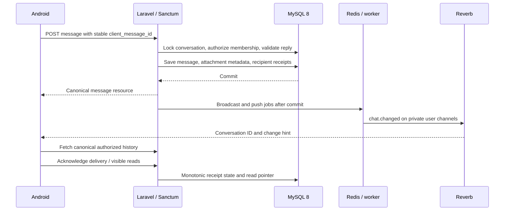

# Architecture

REST is authoritative. Broadcasts contain change hints, not message text or attachment URLs. Each user subscribes to `private-users.{id}` through `/api/v1/broadcasting/auth`; the server only signs their own channel. Current membership is rechecked for every REST and file request. Removal invalidates the removed user's cache and subscription hints cannot grant access to history.

MySQL transactions serialize conversation writes. Canonical private pairs have a unique key. Message UUIDs are unique per sender, across conversations. A payload digest compares conversation, body, reply, and image bytes; a retry returns the same message, while UUID reuse with another payload returns 409. Client retries retain the original UUID and payload. Broadcast events implement `ShouldDispatchAfterCommit`; push jobs use `afterCommit()`.

Redis backs queues, rate limits, presence (75-second heartbeat TTL), and typing (3-second TTL). The foreground mobile client heartbeats every 30 seconds. Typing clears on the client after 3.5 seconds. Presence is approximate, not a durable user status.

TanStack Query holds server state; Zustand holds session and the in-memory outbox. SecureStore stores only the access token. Sign-out clears message caches and drafts. Drafts intentionally do not survive process termination. Failed drafts remain available for explicit retry within the current session. REST refetch on reconnect, foregrounding, and periodic polling repairs missed notifications; pagination loads older messages. Pusher handles socket reconnection; reconnect reauthorizes private subscriptions.

Private attachments and avatars are stored outside the public web root, with authenticated streaming endpoints and private/no-store responses. Images are size, MIME, and dimension limited. Image requests carry the bearer token. There is no public storage symlink for these files. Password changes and all-token revocation also revoke token-bound push registrations. Push bodies are generic to avoid exposing message content on a lock screen.

Group owners manage names and membership; the API policy also recognizes admins, but this version has no role-promotion endpoint. New members can see group history; their unread pointer starts at the current latest message. Blocking prevents new private messages, invitations by the blocker/blocked pair, typing, profile/presence access, and discovery; it does not erase prior history or filter a shared group's history.

## Production operations

The included Compose stack is for local development and CI. Deploy Laravel behind a TLS reverse proxy and PHP-FPM; supervise queue workers, the scheduler, and Reverb separately. Configure trusted proxy handling for your actual ingress, never an unrestricted proxy list. Use TLS for API and WSS for sockets, managed private MySQL/Redis, least-privilege database credentials, durable private storage, encrypted backups, tested restores, and centralized logs without bearer tokens or message bodies. Scale Reverb with its Redis scaling configuration and route all nodes through one WSS endpoint. Workers and API nodes must share attachment storage.

Monitor queue delay and failed jobs, Reverb connections, API latency/error rates, storage use, and push errors. Retry failed jobs deliberately with `queue:retry`; client retry deduplication does not guarantee exactly-once push delivery. Configure Expo enhanced push security and `EXPO_ACCESS_TOKEN` in backend secrets. The scheduler should prune expired Sanctum tokens and failed queue records.

## Boundaries

This is server-readable messaging, without end-to-end encryption. Existing WebSocket connections are authorized at subscription time; revoking a token blocks REST immediately but does not forcibly disconnect that socket. It may receive change/typing hints until disconnected. Production deployments needing immediate socket revocation must add connection tracking and disconnect enforcement. Reconnect and foreground REST remain authorization boundaries.

There is no durable transactional outbox for recovering the narrow process-crash window between DB commit and queue dispatch. Polling repairs message visibility; guaranteed eventual push delivery requires a durable outbox. Attachment rollback cleanup is implemented, but orphan cleanup and deleted-file retention need a deployment retention policy. Account deletion, password recovery/email verification, abuse moderation, full offline persistence, and group ownership transfer are outside this implementation.
